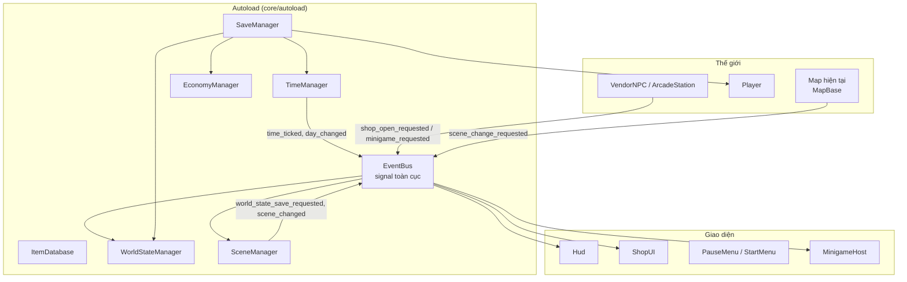
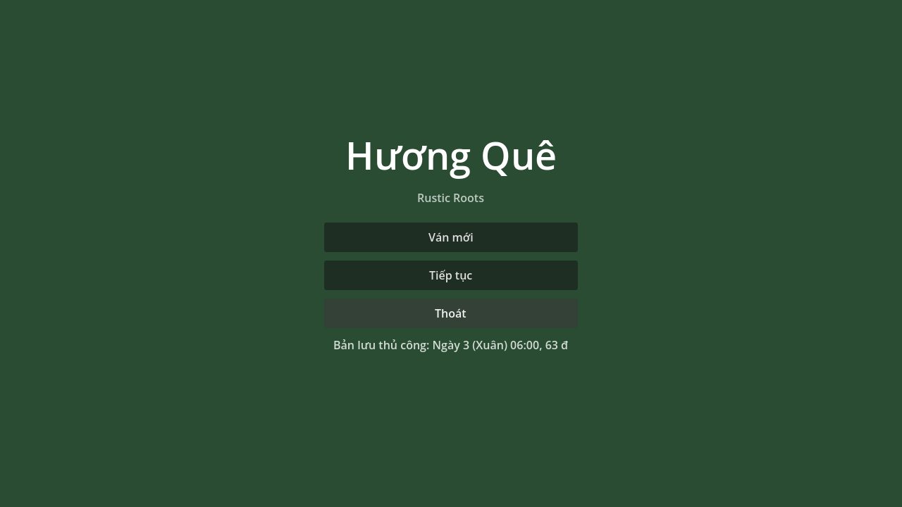
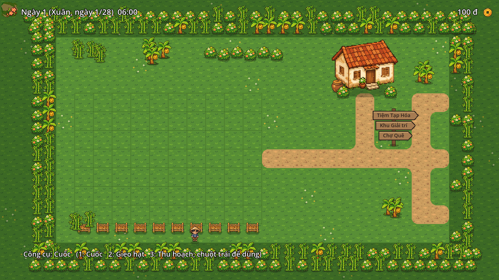
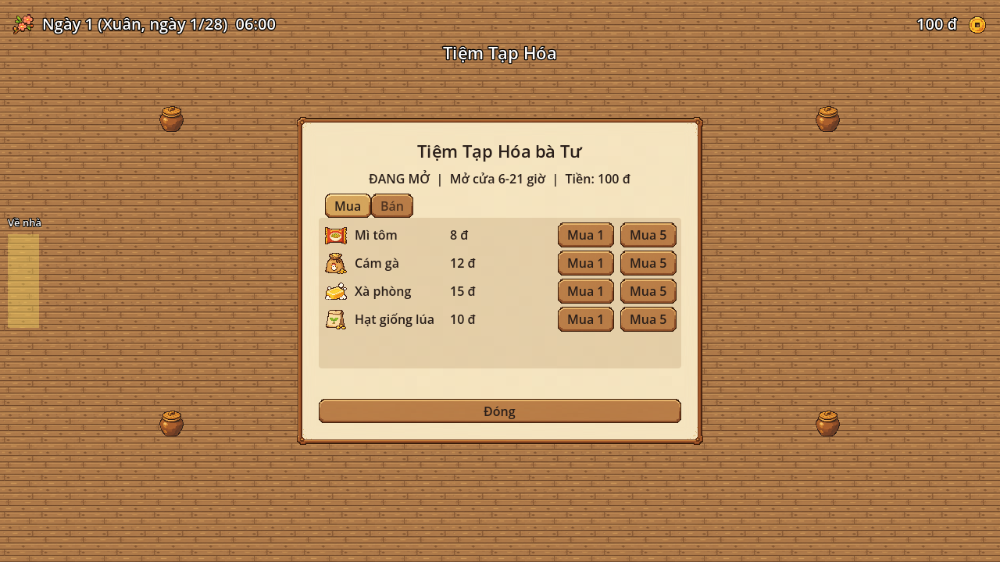
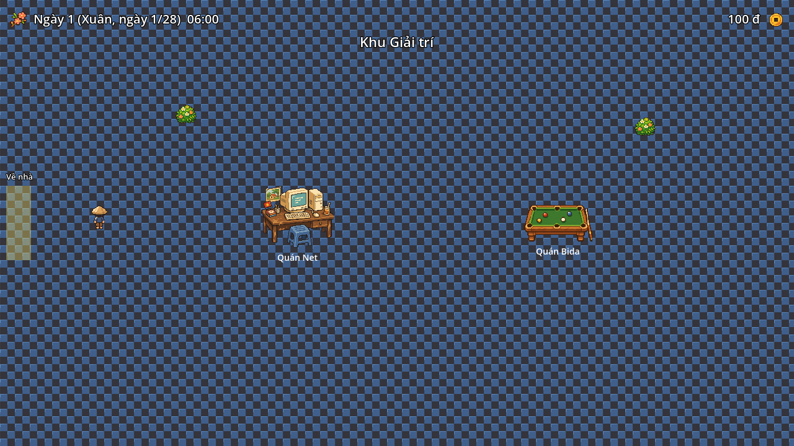
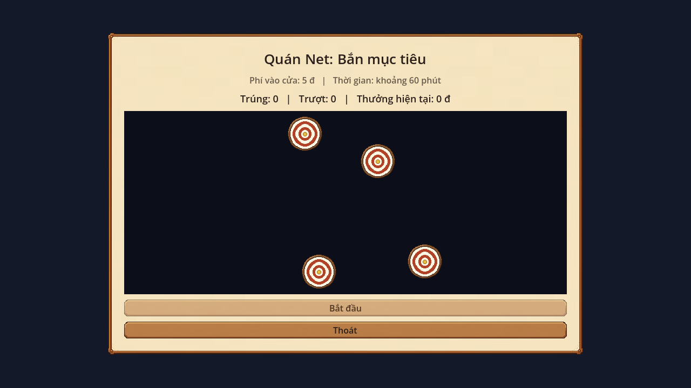
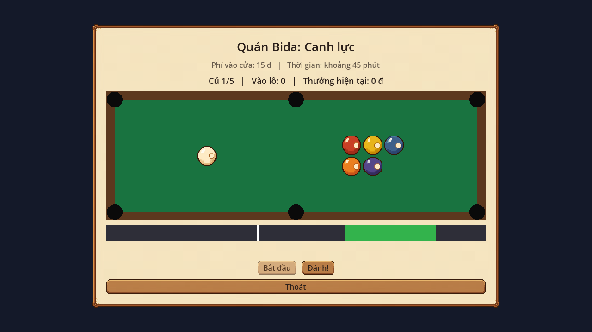
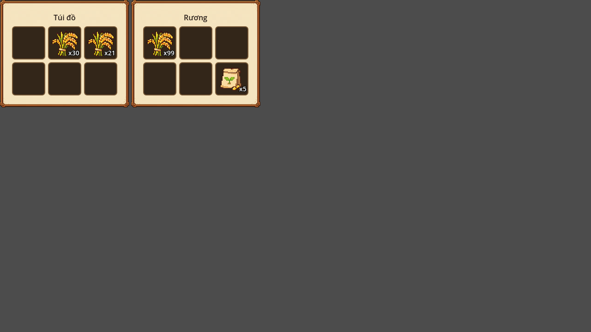
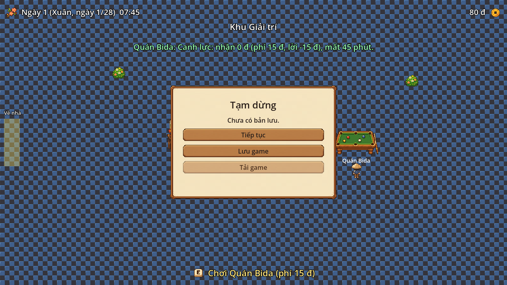

# Hương Quê (Rustic Roots)

Game mô phỏng đời sống nông thôn Việt Nam, 2D nhìn từ trên xuống, viết bằng **Godot 4.7** và **GDScript**.
Đồ án tốt nghiệp ngành Kỹ thuật phần mềm. Trọng tâm của đồ án là **kiến trúc mã nguồn**: hướng dữ liệu
(data-driven), hướng thành phần (component-based), giao tiếp lỏng qua Event Bus, và lưu trạng thái
khi chuyển cảnh.

| Thông tin | |
|---|---|
| Engine | Godot 4.7 (GL Compatibility) |
| Ngôn ngữ | GDScript, dùng static typing |
| Ngôn ngữ giao diện | Tiếng Việt |
| Trạng thái | Bản chơi được ở mức cơ bản; có art pixel-art do AI tạo (xem mục Asset), chưa có âm thanh |

## Chạy game

1. Cài [Godot 4.7](https://godotengine.org/) (bản chuẩn, không cần .NET).
2. Mở thư mục này trong Godot (file `project.godot`), bấm **F5**.
3. Lần đầu mở, Godot tự import; chờ vài giây.

### Điều khiển

| Phím | Việc |
|---|---|
| `W A S D` hoặc mũi tên | Đi lại |
| `E` | Tương tác (nói chuyện với người bán, ngủ ở giường, chơi mini-game) |
| `Esc` | Mở/đóng menu tạm dừng (Tiếp tục, Lưu game, Tải game); đóng cửa hàng |
| Chuột trái | Dùng công cụ lên ô đất (ở khu nhà) |
| `1` `2` `3` | Chọn công cụ: Cuốc, Gieo hạt, Thu hoạch (ở khu nhà) |

### Cách chơi thử nhanh

1. **Ván mới**, bạn đứng ở khu nhà với 10 hạt giống lúa và 100 đ.
2. Bấm `1`, cuốc một ô đất; bấm `2`, gieo hạt; đi đến giường (phía trên) bấm `E` để ngủ.
3. Lúa chín sau 4 ngày; bấm `3` để thu hoạch.
4. Ra lối phải: **Tiệm Tạp Hóa** (mở 6h-21h), **Chợ Quê** (mở 5h-11h, hàng ngẫu nhiên mỗi ngày),
   **Khu Giải trí** (Quán Net, Quán Bida) để mua bán và chơi mini-game kiếm tiền.

## Tính năng đã có

| Hệ thống | Mô tả |
|---|---|
| Thời gian và lịch | Đồng hồ chạy bằng `Timer`, 1 giây thật = 10 phút game; 4 mùa, mỗi mùa 28 ngày; phát tín hiệu cho hệ thống khác |
| Vật phẩm và kho đồ | Vật phẩm là `Resource`; kho theo ô; cộng dồn, tràn kho, kéo/thả trong một kho và giữa hai kho |
| Nông trại | Cuốc, gieo, cây lớn theo ngày, héo khi sang mùa không hợp, thu hoạch vào kho |
| Giao thương | Một giao diện cửa hàng dùng cho mọi người bán; tiệm tạp hóa hàng cố định, chợ hàng ngẫu nhiên mỗi ngày; giờ mở cửa |
| Bản đồ | Sân nhà (viền rặng cây, đường đất bo góc, biển chỉ đường), trong nhà (giường), Tiệm Tạp Hóa, Chợ Quê, Khu Giải trí; chuyển map có hiệu ứng mờ; trạng thái map được nhớ |
| Mini-game | Quán Net (bắn mục tiêu), Quán Bida (canh lực); trả kết quả (tiền, thời gian) về thế giới chính |
| Lưu/nạp | File JSON, ghi an toàn, tự lưu khi sang ngày mới, màn hình chính "Ván mới / Tiếp tục" |

## Kiến trúc

### Tổng quan



### Ba nguyên tắc thiết kế

**1. Hướng dữ liệu.** Số liệu game nằm trong `Resource` (file `.tres` ở `data/`), không nằm trong code.
Thêm một vật phẩm mới chỉ cần thả file `.tres` vào `data/items/`; `ItemDatabase` tự quét và đăng ký.

| Resource | Nội dung |
|---|---|
| `ItemData` | id, tên, icon, nhóm, giá gốc, có cộng dồn không |
| `CropItemData` (kế thừa `ItemData`) | số ngày lớn, vật phẩm thu hoạch, số lượng, các mùa gieo được |
| `VendorData` | giờ mở cửa, hàng cố định, kho hàng ngẫu nhiên, hệ số giá mua/bán, nhóm hàng thu mua |

**2. Giảm phụ thuộc bằng Event Bus.** UI và hệ thống lõi không gọi trực tiếp nhau. Ví dụ: người bán
không biết giao diện cửa hàng tồn tại, nó chỉ phát `EventBus.shop_open_requested`; `ShopUI` tự nghe
và mở. Nhặt đồ phát `item_picked`, HUD tự cập nhật.

| Nhóm | Tín hiệu chính |
|---|---|
| Thời gian | `time_ticked(hour, minute)`, `hour_changed`, `day_changed(day)`, `season_changed`, `day_ended` |
| Kho đồ | `item_picked`, `item_used`, `inventory_changed(owner_id)` |
| Kinh tế | `money_changed`, `shop_open_requested`, `shop_opened`, `shop_closed`, `transaction_completed` |
| Tương tác | `interaction_started`, `interaction_prompt_changed`, `toast_requested` |
| Nông trại | `tile_tilled`, `crop_planted`, `crop_harvested`, `crop_withered` |
| Bản đồ | `scene_change_requested`, `scene_changed`, `world_state_save_requested` |
| Mini-game | `minigame_requested`, `minigame_started`, `minigame_finished(id, result)` |
| Lưu/nạp | `game_saved`, `game_loaded` |

**3. Thành phần thay vì kế thừa sâu.** Hành vi nằm trong các `Node` độc lập gắn vào thực thể:
`InventoryComponent` (gắn vào Player, rương, kệ hàng), `InteractableComponent`, `VendorComponent`,
`FarmField`, `SceneExit`, `SpawnPoint`. Chỉ có hai chỗ dùng kế thừa nông: `CropItemData` kế thừa
`ItemData`, và các map kế thừa `MapBase` (một tầng).

### Lưu trạng thái khi chuyển map

`SceneManager` giữ `Player` sống qua các lần chuyển; chỉ map bị thay. Trước khi dỡ map cũ nó phát
`world_state_save_requested`; `WorldStateManager` hỏi mọi node thuộc nhóm `world_persistent`
(vd. `FarmField`) và lưu trạng thái theo từng map. Khi quay lại, `scene_changed` kích hoạt khôi phục.
Vì lúc vắng mặt vườn không còn trong cây (không nghe được `day_changed`), `FarmField` tự **bù số ngày
đã trôi** khi nạp lại.

### Lưu game

`SaveManager` gom `get_save_data()` của các hệ thống (thời gian, tiền, trạng thái các map, kho đồ
Player, map và vị trí) vào một file JSON ở `user://saves/`. Ghi qua file tạm rồi đổi tên; nạp kiểm tra
hợp lệ trước khi đổi bất kỳ trạng thái nào, nên file hỏng không làm hỏng ván đang chơi.

Cấu trúc thư mục chi tiết: [docs/FOLDER_STRUCTURE.md](docs/FOLDER_STRUCTURE.md).

## Asset (hình ảnh)

Toàn bộ hình ảnh là pixel-art do AI tạo theo một khối phong cách và bảng 17 màu chung
(prompt trong [docs/ASSET_PROMPTS.md](docs/ASSET_PROMPTS.md)), rồi được xử lý bằng công cụ trong repo:

| Bước | Công cụ |
|---|---|
| 1. Ảnh gốc (20 ảnh) | `assets/art/source/` (Godot bỏ qua thư mục này nhờ `.gdignore`) |
| 2. Cắt, thu về đúng cỡ pixel, xoá nền hồng tím, khử viền | `bash tools/process_assets.sh` (dùng [tools/slice_sheet.gd](tools/slice_sheet.gd)) |
| 3. Gắn icon, ảnh cây, ảnh người bán vào dữ liệu `.tres` | `godot --headless --path . -s tools/assign_art.gd` |

Kết quả nằm trong `assets/art/`: `tiles` (nền đất 48x48), `crops` (cây lúa 3 giai đoạn), `characters`
(Player 3x4 khung 32x48, hai NPC), `icons` (10 vật phẩm 32x32), `props` (nhà, giường, quầy, sạp, máy tính,
bàn bida, cây cối), `ui` (khung giấy, nút, icon HUD, logo, nền màn hình chính), `minigames`.
Mỗi ảnh được thu về cỡ "1 pixel ra = 1 pixel nghệ thuật" của chính nó (AI vẽ mỗi ảnh một cỡ khác nhau),
nên nhân vật và NPC cao bằng nhau dù pixel gốc to nhỏ khác nhau.

Ảnh nằm trong dữ liệu chứ không nằm trong code: `ItemData.icon`, `CropItemData.growth_sheet`,
`VendorData.npc_sheet`. Thêm vật phẩm, cây hay người bán mới chỉ cần thêm file `.tres` kèm ảnh.

## Kiểm thử

Bộ test chạy bằng chính Godot, không cần thư viện ngoài:

```bash
GODOT=/duong/dan/toi/godot bash tests/run_all.sh
```

| Bài test | Kiểm tra |
|---|---|
| `test_time_manager` | Đồng hồ, tín hiệu, đổi ngày/mùa/năm, giờ mở cửa, lưu/nạp |
| `test_inventory` | Thêm/bớt, tràn kho, kéo/thả, chuyển kho, lưu/nạp qua JSON |
| `test_farm_field` | Cuốc, gieo, lớn theo ngày, héo khi đổi mùa, thu hoạch, công cụ nối kho đồ |
| `test_shop_logic` | Kho hàng theo ngày (xác định), mua/bán, giờ mở cửa, các lỗi |
| `test_home` | Bố cục sân nhà (vùng chơi, rặng cây, cụm cây, bóng đổ, biển chỉ đường, bo góc đường), vào nhà, ngủ trong nhà |
| `test_art` | Icon vật phẩm, ảnh cây theo giai đoạn, ảnh người bán, hoạt ảnh Player, đồ vật chặn đường, giao diện giấy |
| `test_terrain` | Sheet nền đất 48x48, lát nền bốn map, đổi toạ độ chuột sang ô vườn |
| `test_inventory_ui` | Giao diện kho, kéo/thả giữa hai kho |
| `test_shop_ui` | Giao diện cửa hàng dùng chung, nút mua/bán, khoá khi đóng cửa |
| `test_game_flow` | Luồng chơi trọn vẹn qua các map, vườn được nhớ và tự bù ngày |
| `test_save_load` | Lưu/nạp, file hỏng/sai phiên bản, tự lưu, menu Esc |
| `test_minigames` | Thu phí, dừng đồng hồ, áp kết quả, hai mini-game, các trường hợp biên |
| `test_start_menu` | Màn hình chính (3 pha, mô phỏng mở lại game) |

Lưu ý khi viết test: ở chế độ `godot -s`, script test được compile **trước** khi autoload được đăng ký,
nên test không được nhắc tên class dùng autoload bằng `X.new()` hay `is X`. Chi tiết trong
[tests/test_base.gd](tests/test_base.gd).

## Ảnh chụp

| | |
|---|---|
|  |  |
|  |  |
|  |  |
|  |  |

## Hạn chế hiện tại và hướng phát triển

- Chưa có âm thanh. Art do AI tạo nên mỗi ảnh có mật độ pixel hơi khác nhau (nhà được phóng 2 lần cho cân với Player); nhân vật chỉ có hoạt ảnh đi bộ, chưa có hoạt ảnh cuốc/gieo/thu hoạch; đồ vật luôn vẽ dưới Player nên khi đi sau nhà Player vẫn hiện đè lên nhà.
- Chưa có: nấu ăn, giặt đồ, chuồng trại (nuôi gà/lợn), NPC có hội thoại, nhiều sạp ở Chợ.
- Các con số (giá, thưởng mini-game, tốc độ) là số tạm, chưa cân bằng bằng chơi thử.
- Chỉ có một slot lưu thủ công và một slot tự lưu; chưa có cơ chế nâng cấp định dạng file lưu giữa các phiên bản.
- Chưa có menu "Về màn hình chính" trong lúc chơi.
